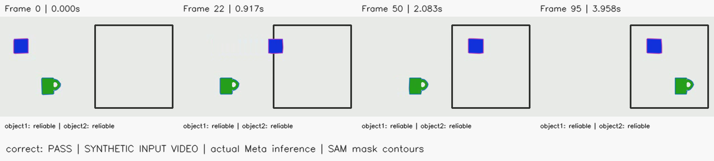
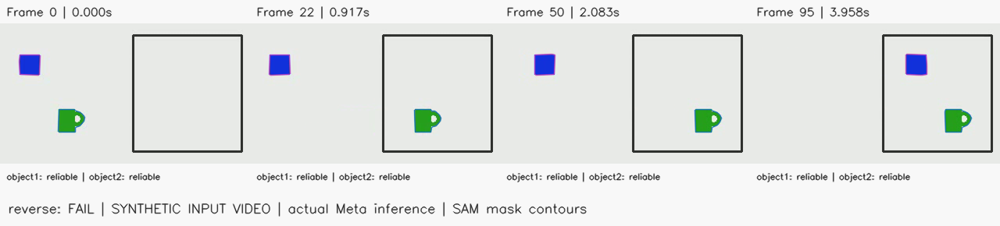
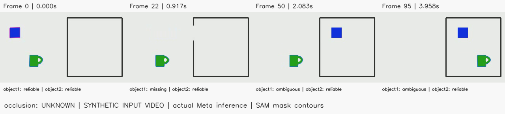
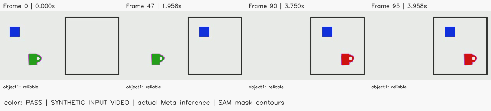
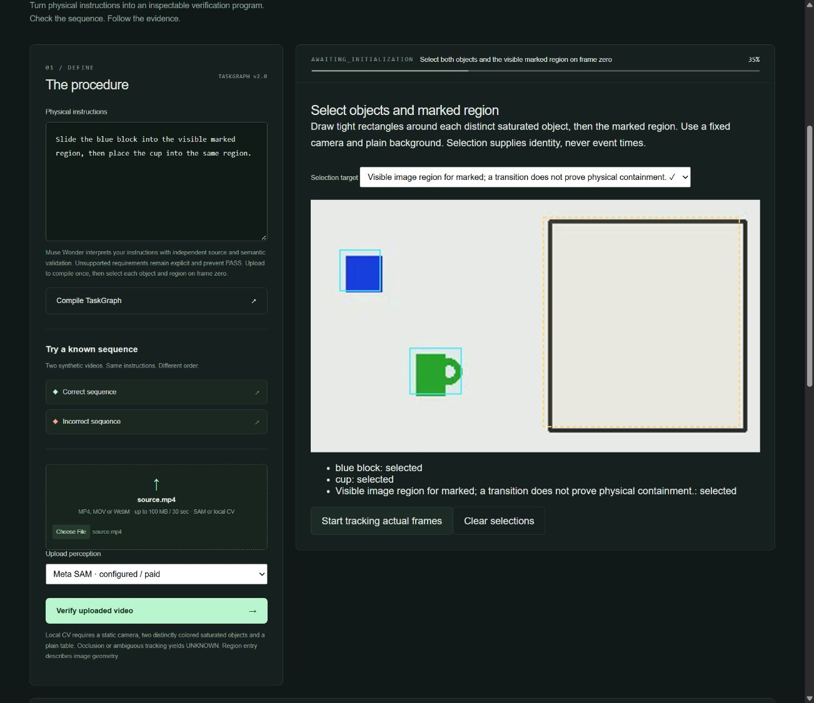
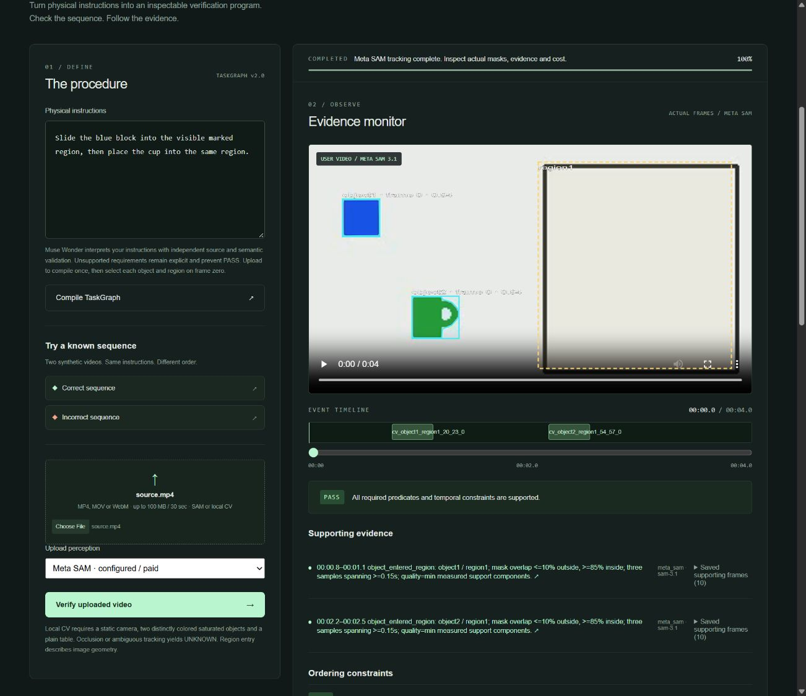
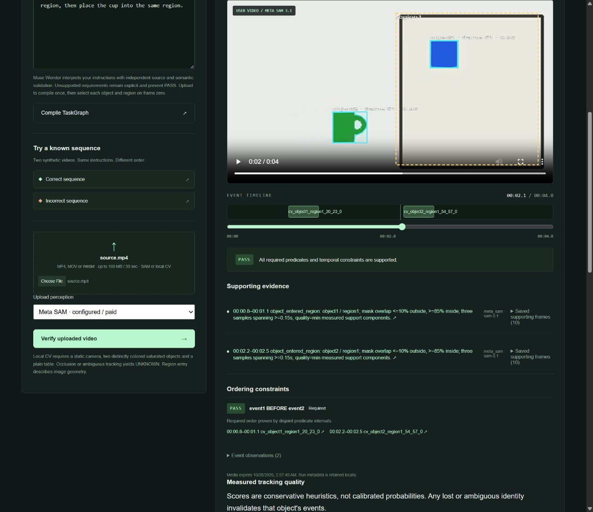

# Milestone 4.2 — actual Meta inference and deterministic evidence

Validated 2026-10-28, Asia/Bangkok. The application now completes upload → Wonder compilation → immutable frame-zero selection → SAM segmentation → visual observations → deterministic evaluation → timestamped evidence. Spark also supplies a validated final color-state observation. **All input videos in this report are generated animations. Genuine-camera validation remains unverified.**

## Actual calls, failures and budget

This session completed **21 Wonder, 14 SAM and 2 Spark inference POSTs**, including the real browser workflow. The [complete capture index](live-validation/index.json) records every attempt, including rejected outputs and an interrupted initial API run. Captures retain actual sanitized provider envelopes, IDs, reported usage, response hashes, exact source/normalized video bytes, graphs, observations, verdicts and audit provenance. Credentials, HTTP headers and reasoning content are excluded. The browser run retains its validated application audit; its raw production envelopes were not separately captured.

The persistent lifetime ledger now has **[private historical cost] committed exposure and [private historical cost] remaining** out of $100. This includes an earlier Wonder failure. Failed/uncertain requests retain their full reservations; accepted adapters settle only with validated actual usage. These are internal exposure and response-usage estimates, not a billing invoice. No ledger reset, automatic paid retry or paid CI call occurred.

The user's explicit live-integration request authorized these manual validations and debugging. Each POST reserved a verified bound in the existing ledger before HTTP. Text bounds use the full published 1,048,576-token context ceiling and capped 4,096 output tokens. SAM uses exact verified video frame count, frame-zero forward prompts and the 50-frame billing minimum. Root `.env` flags remain unchanged and false. The browser demonstration runs one localhost server with explicit process-only paid flags; no deployment or merge occurred.

## Pinned SAM execution

The prepared SAM-only run used the exact reviewed 72-frame video, TaskGraph and selections. Plan SHA-256: `001885ac8f3b42dc2e358521d14c30509d4af4331e3cb1c48802656b50e746e4`.

One actual SAM request returned complete reliable masks for both prompted objects. The one-bit masks decoded correctly, identities remained consistent, and source indices 0–71 aligned with `index/24` timestamps. Detected block entry: 0.917–1.042 seconds. Cup entry: 1.958–2.083 seconds. Deterministic result: **PASS**. Verified usage: 72 billed frames, [private historical cost]. The durable authorization is consumed and the entry point is retired again. [Pinned result](live-validation/sam-pinned-result.json).

## End-to-end results

These results use actual Wonder and SAM output, with actual Spark output in the color case:

| Case and audit | Result | Decisive observations or uncertainty |
|---|---|---|
| [Ordinary-language correct order](live-validation/live-api-v6-correct/report.json) | PASS | Block 0.833–0.958s, cup 2.292–2.417s; disjoint exact-predicate intervals |
| [Reversed order](live-validation/live-api-v2-reverse/report.json) | FAIL | Cup 0.625–0.750s precedes block 2.500–2.625s |
| [Missing action](live-validation/live-api-v2-missing/report.json) | UNKNOWN | Cup entry absent; absence does not prove failure |
| [Repeated action](live-validation/live-api-v2-repeated/report.json) | UNKNOWN | Two block entries; no arbitrary occurrence selection |
| [Occlusion](live-validation/live-api-v2-occlusion/report.json) | UNKNOWN | Block mask missing; later identity remains invalid |
| [Ambiguous identity](live-validation/live-api-v2-ambiguous/report.json) | UNKNOWN | Original object disappears while a similar object appears elsewhere; no identity recovery |
| [Incomplete video](live-validation/live-api-v2-incomplete/report.json) | UNKNOWN | 40 frames end before cup entry; billed minimum is 50 frames |
| [Unsupported sterility requirement](live-validation/live-api-v4-unsupported/report.json) | UNKNOWN | Valid entries retained; required hidden property remains unsupported |
| [Final color change](live-validation/live-api-v5-color/report.json) | PASS | Spark cites frame 0 plus all final frames 90–95; SAM identity remains reliable; evaluator assigns verdict |

The latest natural-language procedure was:

> Slide the blue block into the visible marked region, then place the cup into the same region.






These are frame extractions and actual returned contours. The source scenes themselves are synthetic and labeled accordingly. No physical-recording success is claimed.

## Failures investigated and fixes

- Wonder exhausted the 4,096-token output cap, spending most of it on reasoning. Truncated JSON was rejected. The documented minimal reasoning setting keeps visible output within the cap.
- Live outputs duplicated actions as conditions, shortened instruction text, changed condition scope/checkability, supplied null unsupported reasons, and paraphrased literal visual criteria. Source-specific schemas now constrain exact clause references, independently parsed requirement slots, capabilities and literal criteria. The independent semantic validator is unchanged. No failed output was silently repaired or settled.
- Spark described the visible color change but invented `event_condition1`. That output produced UNKNOWN and retained its reservation. The request schema now binds claims to exact supplied IDs and typed predicates. A subsequent live run returned valid grounded evidence and deterministic PASS. Spark never assigns a verdict.
- The single hardcoded demo sentence was replaced by bounded imperative parsing for move/slide/place, before/after/then, explicit visible regions and unambiguous same-region references. Concrete object nouns and color/size descriptors bind to manual selections. Unsupported qualifiers remain explicit and prevent PASS. Line adjacency creates no order.
- Unsupported-only uploads previously waited for impossible object selection. They now complete UNKNOWN without SAM, retaining source/normalized hashes and transformation provenance.
- Health now lists selectable SAM and reports verified catalog access accurately. Upload help identifies the compiler used by the selected perception mode. OpenCV fallback remains available with local rules.
- An initial manual harness incorrectly overlapped service processes against a single-process database; restart recovery interrupted one run. That attempt remains in the audit. All later validation ran sequentially. Multiple service processes remain unsupported.

## Real browser demonstration

The actual frontend completed video upload, ordinary-language Wonder compilation, rectangle selection, SAM tracking and PASS in job `6eafb93c8b9a4058a42d0f74c19005df`. Boxes were drawn through the browser UI; no event times were supplied. The browser displayed SAM contours, timestamped supporting frames, independent provenance and verified costs ([private historical cost] Wonder, [private historical cost] SAM). Block entry was 0.833–0.958s; cup entry 2.250–2.375s. Clicking an evidence link sought the actual video and updated the overlay.

[Validated browser job audit](live-validation/live-api-browser-correct/report.json). Its production envelopes were not separately captured and it is not used for offline response replay. Exact normalized video bytes and hashes are retained. Independent ffmpeg inspection confirmed source PTS 0, 2.125 and 3.958333 seconds at indices 0, 51 and 95, matching the adapter's 24 fps time base.





The browser input is a generated video, not a genuine camera recording. The local server uses the existing lifetime ledger and process-only configuration: `PROVIDER_MODE=meta_sam`, `META_COMPILER=muse_wonder`, both paid gates true and `META_SPARK_VISUAL=true`. The existing root server credential stays server-side. Root `.env` values remain unchanged and disabled. No credential enters frontend code.

## Validation and reproduction

Fresh local checks: **311 backend tests; Ruff lint and format; strict mypy; 17 frontend tests; ESLint; TypeScript; production build; npm audit (zero vulnerabilities); lock consistency; OSV advisory queries for 38 locked PyPI packages (zero findings); credential scan; diff checks.** Tests cover malformed masks, missing frames, identities, exact predicates, conflicting observations, unsupported clauses, deterministic grounding and replay of actual captured responses. Test-only injected responses are explicitly synthetic. Local Docker engine is unavailable; hosted Docker build results and the added runtime check are recorded below.

Replay saved actual responses offline, without credentials, ledger changes or network:

```powershell
uv run python -m scripts.replay_live_validation live-api-v6-correct
uv run python -m scripts.replay_live_validation live-api-v2-reverse
uv run python -m scripts.replay_live_validation live-api-v2-occlusion
uv run python -m scripts.replay_live_validation live-api-v5-color
```

Replay verifies response/video SHA-256, validates the captured Wonder graph through current grounding, decodes actual SAM masks, validates Spark where present, regenerates observations and compares the complete deterministic evaluation. Replay is regression evidence, not another live call.

Current official Meta documentation and prices were re-read before calls on 2026-10-28: [pricing](https://dev.meta.ai/docs/pricing-rate-limits), [models](https://dev.meta.ai/docs/models), [SAM prompts](https://dev.meta.ai/docs/sam/segmenting), [mask grammar](https://dev.meta.ai/docs/sam/reading-segmentation), [chat schemas](https://dev.meta.ai/docs/api-reference/chat-completions/schemas), [structured output](https://dev.meta.ai/docs/structured-output), [reasoning control](https://dev.meta.ai/docs/reasoning), and [image input](https://dev.meta.ai/docs/image-understanding). Authentication is server-side Bearer at fixed origin `api.meta.ai`. Fresh authenticated catalogs and successful requests establish access to the three exact model IDs used.

## Remaining genuine-recording requirement and scope

No genuine camera recording is available in this workspace. Capture **three unedited, held-out 10–30 second clips under 100 MB** with a fixed overhead camera, plain table, blue block, distinctly colored cup and neutrally taped rectangular target. Keep separate lanes and both objects outside the target at frame zero. Hold still one second before and after actions:

1. Block fully into target, pause at least one second, then cup fully into target: expected PASS.
2. Cup first, pause, then block: expected FAIL.
3. Hide the block near the target boundary during its move, reveal it, then move the cup: expected UNKNOWN. Do not supply identity recovery or event times.

Keep camera position, lighting, shapes and sizes stable. Supply original files and capture provenance. [Exact capture and preparation instructions](recording-capture.md) describe hashes and the held-out harness. The app supplies manual first-frame identity/region binding; no manual event times are accepted. Those recordings must still establish PASS/FAIL/UNKNOWN with inspected evidence before real-world validation is claimed.

Language support remains bounded to independently checkable predicates and source semantics; arbitrary prose and hidden/physical-containment claims may remain UNKNOWN. Spark covers explicit final visual states, not arbitrary transient actions or unseen properties. Model confidence is a heuristic. SAM identity cannot recover after disappearance. Scene-motion detection does not prove physical camera immobility. Runtime is one process with two worker threads and a persistent data volume.

Material integrations: actual Meta Model API HTTP, current official Meta documentation via web access, authenticated GitHub connector/Git credential helper for PR #3 and hosted checks, OSV advisory API, and browser integration for the local UI. GitHub CLI is unauthenticated; connector/Git access works. Local Docker engine is unavailable. Neither PR #2 nor PR #3 is merged.


## Hosted Docker validation

Both hosted checks for integration commit `12d7db437157e538ddc885dcbd167a7e3b9cd98b` passed, including Docker builds: [push run](https://github.com/mattwatson7/reality-compiler/actions/runs/40565526182) and [PR run](https://github.com/mattwatson7/reality-compiler/actions/runs/40565730544).

A follow-up CI step now starts the built image with `CI=true`, fixture/local-rule providers and all paid/Spark flags explicitly false. `scripts/docker_smoke.py` refuses live-enabled health before any POST, checks the served production frontend and video playback, verifies bundled fixture PASS/FAIL with timestamped evidence, and requires zero reserved cost. The same HTTP smoke passed locally against an isolated offline instance; the built-container execution is checked by [the latest PR checks](https://github.com/mattwatson7/reality-compiler/pull/3/checks). The isolated local test process was stopped, leaving the demonstrated live app running.

After adding this runtime check, the complete local suite passed again: 311 backend tests, 17 frontend tests, Ruff lint/format, strict mypy, ESLint, TypeScript and production build. A further credential scan covered 207 tracked/unignored files with no configured-key occurrence. CI annotations on the earlier successful jobs were nonblocking action-runtime deprecation/runner-image migration notices; they were not test or Docker failures.


The first container-runtime jobs exposed a readiness-probe race: Docker's port mapping accepted TCP then reset before the HTTP worker finished importing. The probe now retries bounded read-only GET readiness checks on resets/aborts/timeouts, while POSTs remain single-attempt and paid gates are validated before fixture submission. Three explicit transport-race regressions pass in addition to the two paid-gate guard tests. The final hosted run, including actual container startup, remains available from the latest PR checks link above.


The readiness fix passed both actual hosted runs on `d41cebbf9fbbbd6b559faf38beb9d43fa05489a5`: [push](https://github.com/mattwatson7/reality-compiler/actions/runs/40567489880) and [PR](https://github.com/mattwatson7/reality-compiler/actions/runs/40567500913). The container runtime emitted `{"frontend":"served","fixtures":{"correct":"PASS","incorrect":"FAIL"},"paid_inference":false,"cost_microusd":0}`. All backend/frontend checks and Docker build also passed. The current backend collection contains 314 tests, including the three readiness regressions.

A final UI audit clarified the standalone TaskGraph preview independently of upload mode: when the global compiler is live, its button explicitly says `paid Wonder`; nearby compiler guidance is labeled as applying to uploads. This avoids implying that a preview uses local rules merely because an OpenCV upload is selected. All 17 frontend tests, ESLint, TypeScript and production build passed after this labeling change. No extra inference was needed.
