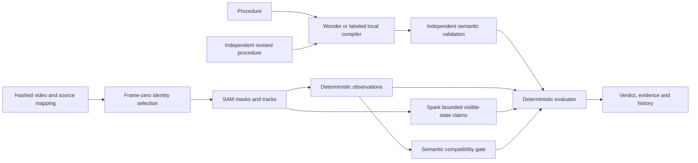

# Reality Compiler

**Describe what should happen. Show what happened. Prove whether they match.**

One-sentence differentiator: Reality Compiler independently compiles physical procedures and rechecks them against reusable, timestamped visual evidence, explaining exactly why each result is PASS, FAIL or UNKNOWN.

## Short project description

Reality Compiler checks whether video evidence supports a written physical procedure. Muse Wonder compiles inspectable requirements, SAM 3.1 tracks selected objects, and Muse Spark interprets bounded visible states. A deterministic evaluator links PASS, FAIL or UNKNOWN to evidence. Change the procedure and compare results using compatible saved perception, without repeating expensive tracking.

## Problem, audience and path to value

A recording can document a workstation task while leaving reviewers unsure which step happened first or whether the evidence is sufficient. Our initial audience hypothesis is robotics researchers and teams reviewing simple fixed-camera assembly or training procedures. They need a reproducible explanation, not just a confident video summary.

The prototype demonstrates an evidence-review workflow: select known objects, inspect grounded observations, check the intended order, then compare another procedure against the same observations. A future paid product could charge for analysis and team review while making compatible revisions inexpensive. These are product hypotheses; customer demand, market size, willingness to pay, time savings and production accuracy have not been validated. The current product is a local research prototype, not a safety certification system or deployed manufacturing monitor.

## Technical description and Meta roles

Intention, perception and judgment are separate. Muse Wonder (`muse-wonder-1.0`) turns bounded procedural language into typed TaskGraph requirements; independent semantic validation checks the meaning against the source. Manual selections bind compiled identities to immutable normalized frame zero. SAM 3.1 (`sam-3.1`) supplies masks and tracks. Deterministic observations conservatively establish supported image-space events. Muse Spark (`muse-spark-1.3`) contributes bounded visible final-state claims when appropriate. Spark is not required for the generated order comparison and never decides the verdict.

The deterministic evaluator checks exact predicates, arguments, evidence intervals and ordering. Missing identity or ambiguous observations remain UNKNOWN. An independently compiled revision passes a compatibility gate before it can reuse saved perception. Original evaluations remain unchanged; comparison history and independent provider provenance remain inspectable.

FastAPI/Pydantic, SQLite, ffmpeg/OpenCV and two local worker threads serve a React/TypeScript evidence interface. Media identities and provider provenance bind evidence to its source. Keys remain server-side. Retention and expiry apply to playback; audit metadata survives. A persistent data volume and one application process are required.

## Demonstrated results and precise boundaries

The rights-cleared generated clip supplies a clear comparison: original observed order PASS, reversed required order FAIL, and original order plus unsupported sterility UNKNOWN. These are captured, evidence-backed evaluations, not canned verdict selectors. The offline judge mode imports actual captured SAM observations; edited instructions compile locally and run through the normal deterministic re-evaluator without new Meta requests.

Milestone 5 captured 17 authorized inference POST responses: nine Wonder, five SAM and three Spark. Four third-party camera recordings provided limited final-visibility results and identity-loss uncertainty; they did not establish the three controlled physical-procedure acceptance cases. The public demonstration uses generated media only. Controlled correct, reversed and occluded camera recordings remain unavailable; genuine-camera PASS/FAIL/UNKNOWN procedure coverage remains pending.

Supported language, scene assumptions and predicates are bounded. Image-region entry does not prove physical containment, contact or successful insertion. Occlusion and uncertain identity can invalidate decisive evidence. New semantic objects or regions can require new selection/perception. Legacy recordings retain normalized evidence times; do not claim recoverable frame-exact source timing for old runs. See the final [milestone report](report.md) for the implemented mapping behavior and checks.

The lifetime ledger remains **[private historical cost] of $100**, with **[private historical cost]** remaining. Paid gates remain disabled; replay and tests make no paid requests. No new live inference, finished demo MP4, public deployment, submitted entry or accepted waiver is claimed by these materials.

## Judge delivery

Use [local judge reproduction](judge-reproduction.md) to launch the real interface without Meta credentials, verify captures and independently edit compatible instructions. The [two-minute production package](demo-production.md) provides narration, shot list, interaction sequence and recording checklist. [Permissions inventory](provenance-permissions.json) records the precise third-party source matches and public-media restrictions.

## Official event verification — October 28, 2026

The [Meta event page](https://dev.meta.ai/events/global-hackathon) currently lists submission by **November 4, 2026, 9:00 PM US Eastern**, equivalent to **November 5, 2026, 02:00 UTC / 09:00 Bangkok**. Judging is November 4–8 and closing November 9. The organizer reserves the ability to change dates; recheck before submission.

The [Cerebral Valley official rules](https://cerebralvalley.ai/e/meta-ai-developer-hackathon/waiver) were read in the actual browser on October 28 after the text-fetch tool could not retrieve them. They require Meta AI tooling and weight project judging as impact 30%, Meta tooling 25%, execution 20%, and demo 25%. One project enters one track; indie teams have at most four members and an authorized representative identifies the team. Entrants must have been accepted and meet eligibility requirements. Rules require rights in submitted materials and compliance with applicable open-source licenses. The entrant must personally review and accept applicable terms; this research did not accept them.

The [submission URL](https://cerebralvalley.ai/e/meta-ai-developer-hackathon/hackathon/submit) was opened in the signed-out browser on October 28. It displayed the event description and a Sign In link, without the project form. **Exact required fields, character limits, video duration/file limits, upload types, accepted-participant access and final submission controls are not verified.** The following checklist is preparation, not an asserted portal schema. Recommended theme: Push the Frontier, based on the event's robotics/manufacturing/physical-systems theme; the entrant must choose the eligible track.

## Submission readiness checklist

- [x] Short pitch, differentiator, technical architecture and model roles written.
- [x] Public demo shot list uses generated media and explicitly labels captured-evidence review.
- [x] Known limitations and pending controlled-camera validation disclosed.
- [x] Official public deadline and rules rechecked with dated links.
- [x] Machine-readable media provenance and permissions inventory prepared.
- [x] Final verification and fresh browser evidence linked from the [milestone report](report.md).
- [ ] Entrant confirms accepted-participant access, eligibility, team roster, representative and track.
- [ ] Entrant inspects signed-in form and supplies exact required fields and limits.
- [ ] Continuous demo recording exported and checked against the actual portal rules.
- [ ] Entrant reviews source/public assets, terms, final descriptions, repository URL and any requested demo link.
- [ ] Explicit approval obtained for any external upload, publication or submission. No PR merge is authorized.

Material integrations for this documentation: official Meta/Cerebral Valley web research and actual browser inspection; authenticated GitHub connector for authoritative OmniReset website source; Hugging Face public repository metadata and direct authoritative media streams for SHA-256 comparisons. No inference endpoint or paid service was called. The unavailable authenticated participant form is the remaining portal-access limitation.
