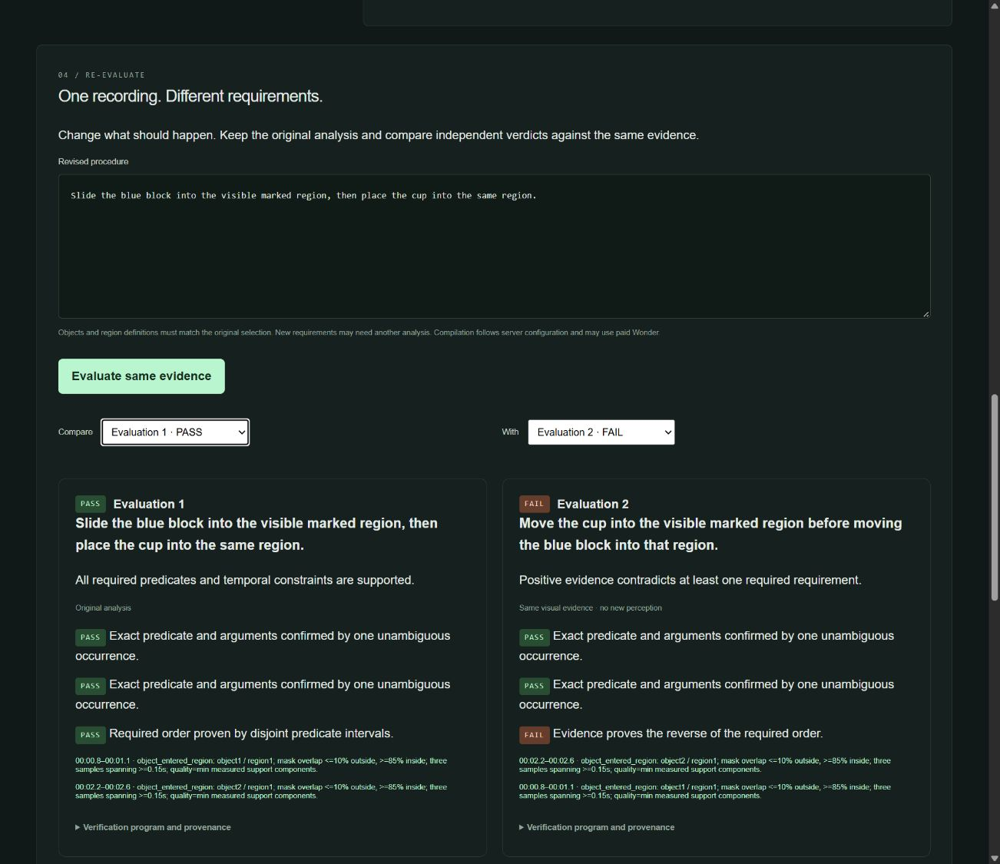
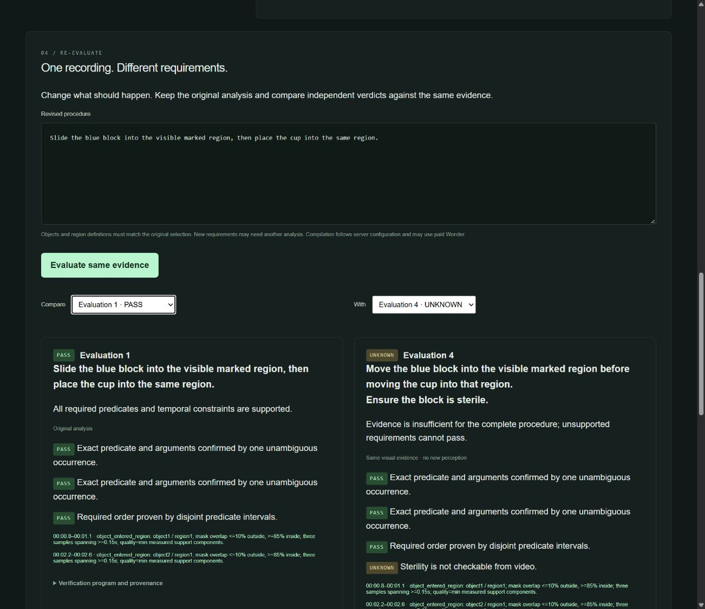

# Milestone 5 — reusable evidence and genuine-camera evaluation

Historical milestone record. [Milestone 5.1](../milestone-5.1/report.md) supersedes
the current delivery status: new uploads now have decoder-frame source mapping,
exact source attribution is resolved for all four research recordings, and
updated judge/demo materials are available. Historical runs remain unchanged.

Reality Compiler now preserves a completed analysis and appends independently
compiled procedure evaluations. The browser compares instructions, TaskGraphs,
verdicts and timestamped evidence. Four supplied camera recordings were inspected
and evaluated with real Meta inference and the local OpenCV baseline.

## Actual camera results

Expectations, selections and segment choices were recorded before inference in
[predeclared-procedures.json](predeclared-procedures.json). Full job metadata,
tracks, observations, hashes, inference usage and results are in
[live-results.json](live-results.json). Original decode measurements and
attribution/limitations are documented in [recordings.md](recordings.md).

| Recording / selected interval | Procedure | Actual Meta result | OpenCV result | Evidence quality / limitation |
|---|---|---|---|---|
| cam1.mp4 / entire 10.767s | Move the purple block into the visible image region target | UNKNOWN | UNKNOWN | SAM lost confidence/foreground identity; CV rejected scene motion. No event was invented. Gripper occlusion prevents containment claims. |
| 3_16_peg_eval_continual_success.mp4 / first 6s | At end, the green box is visible | PASS | UNKNOWN | SAM retained base identity; Spark supported normalized frames 140–145, 5.833–6.083s. CV had competing same-color components. |
| real_nonprehensile.mp4 / first 8s | At end, the green box is visible | PASS | UNKNOWN | SAM retained base identity; Spark supported the final six normalized frames. CV quality failed at frame zero. Partial gripper overlap does not establish insertion. |
| real_perturb.mp4 / first 8s | At end, the green box is visible | PASS | UNKNOWN | Base stayed identifiable despite human manipulation of the peg/gripper; Spark supplied final visibility. CV had competing components. Later view change was excluded before inference. |

The three PASS results concern **final visibility of a selected base**, not
successful robotic insertion, general procedure understanding, or a benchmark
of broad real-world reliability. Representative start/middle/end contours and
final evidence frames were inspected rather than relying only on verdict text.
Local screenshots/contact sheets are under `output/m5-evidence` and
`output/m5-inspection`; research-video imagery is not redistributed until its
license is established. No supplied footage was replaced or synthesized.

## Procedure re-evaluation

The genuine-camera peg run was re-evaluated in the actual browser. Its original
visibility procedure produced PASS. Adding “Ensure the box is sterile.” produced
UNKNOWN, with the original Spark visibility evidence retained. Both independently
compiled graphs and verdicts persist in [real-peg-comparison.json](real-peg-comparison.json).
No SAM or Spark call was repeated for the revision.

The supplied real footage did not establish two independently reliable temporal
events for the required order comparison. The permitted fallback used the
previously verified generated block/cup recording, uploaded through the browser,
compiled with Wonder, selected on frame zero, and tracked with actual SAM.

| Independently compiled instruction | Verdict using the same visual evidence |
|---|---|
| Slide the blue block into the visible marked region, then place the cup into the same region. | PASS |
| Move the cup into the visible marked region before moving the blue block into that region. | FAIL |
| Reverse order plus a sterility requirement | FAIL: the proven ordering violation remains decisive; sterility itself is UNKNOWN |
| Observed block-before-cup order plus a sterility requirement | UNKNOWN |

The two event intervals were approximately 0.833–0.958s and 2.250–2.417s;
supporting evidence spans 0.750–1.125s and 2.167–2.583s. Exact timestamps, masks,
selection boxes and results are in [generated-comparison.json](generated-comparison.json).
Compiled object IDs change in the reversed instruction; semantic definitions,
not matching IDs, determine compatibility. The original verdict remains intact.

## Implemented boundaries

- `POST /api/jobs/{id}/evaluations` compiles one revised instruction and stores a
  separate append-only result. `GET` lists the original and revision history.
  Histories are bounded to 50 revisions per recording. An expired run retains
  history but rejects new evaluations.
- Evidence reuse checks exact object/region descriptions and grounding prompts,
  coordinate semantics, typed predicates and scope. It maps compiler-local IDs,
  preserves repeated/unusable/conflicting observations and source-wide ID
  collision invalidation, and never reruns perception automatically.
- New definitions/predicates produce UNKNOWN with an explicit request for a new
  upload/selection. The evaluator contains no filename-specific answers or
  recording-specific verdict rules. Unsupported requirements cannot produce PASS.
- A completion seal covers perception, provenance and time-base metadata. The
  normalized file and any retained SAM mask text are hash-checked. Expiry and
  fingerprint checks are repeated transactionally when appending a result.
- Upload originals now remain alongside normalized media until expiry. New SAM
  runs preserve validated mask text and its digest, including uncertain tracks.
  Historical validation runs retain their raw masks in sanitized response captures.
- The local observer now supports conservative final visibility from an unbroken
  reliable sampled track through the last frame. It asserts sampled image
  visibility only. SAM final interpretation remains with Spark, avoiding duplicate
  independent claims. No new physical-contact/containment predicate was added.
- Source declarations distinguish unspecified, generated and camera footage.
  Offline capture review has a separate explicit label, always forces local
  compilation, and cannot enable paid calls even on a Wonder-configured server.

## Live calls and budget

[capture-index.json](capture-index.json) identifies **17 actual inference POSTs**:
9 Wonder, 5 SAM and 3 Spark calls. Sanitized responses retain contract fields,
geometry and usage; reasoning and credentials are excluded. The initial
authenticated catalog confirmed all three selected models. Official contracts,
authentication and pricing were refreshed before dispatch; see
[Meta contract update](../meta-api-contracts.md).

New committed exposure was **[private historical cost]**. The lifetime ledger moved from
[private historical cost] to **[private historical cost]**, leaving **[private historical cost]**. The cube SAM request retained
its reservation after tracking uncertainty. Successful adapters settled only
verified usage; the ledger was never reset. One concurrent browser attempt was
rejected by the single-request limit before dispatch and was later submitted
explicitly after perception finished. No automatic paid retry occurred.

The authorized live server was stopped. The current local server and persistent
root flags have paid inference disabled. No paid call occurred in tests/CI.

## Reproduction and judge delivery

[Submission materials](submission.md) include the project pitch, architecture,
verified official rules/deadline, setup, storyboard/narration and judge workflow.
The official deadline is November 5, 2026, 9:00am Bangkok. The signed-out portal
did not expose detailed submission fields. No waiver was accepted, submission
sent, deployment performed or PR merged.

`uv run python -m scripts.replay_milestone5` verifies all response hashes and
recomputes captured deterministic results without network access.
`uv run python -m scripts.open_capture_review` creates a fresh, labeled offline
browser review using the rights-cleared generated recording and actual captured
SAM observations. It preserves existing jobs and the lifetime ledger. Open its
printed `/?run=...` path on the local server; edit instructions and compare.

External source media remain under `recordings/external`; segments and camera
screenshots remain local. The supplied actual filenames differ from those in
the objective. Exact source-byte attribution and redistribution permission are
not established for every research asset. Original-to-normalized frame-exact PTS
mapping remains unverified; no source timestamp is fabricated. The original
three controlled held-out physical-camera acceptance cases remain unavailable.
There is no authenticated public deployment or continuous browser recording API.

Validation commands and security results are recorded in
[verification.json](verification.json). Local Docker engine access is unavailable;
the updated loopback smoke passed against an isolated local server. Hosted CI
builds Docker and checks the running container's frontend, playback, fixture
PASS/FAIL, revision persistence, unsupported UNKNOWN and zero inference cost.
Check PR #3's final commit checks for the actual hosted result.

Material external integrations: authenticated GitHub connector for PR state and
CI; authorized direct Meta Model API for live inference; official Meta/Cerebral
Valley research through web and browser; browser automation for upload, selection,
evidence seek and comparison; OSV vulnerability API. No OpenAI API or new plugin,
dependency, global configuration, public deployment or external messaging was used.
