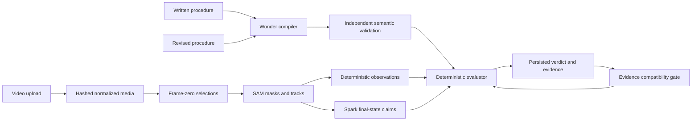

# Reality Compiler

Historical submission draft. Use the [current milestone 5.1 package](../milestone-5.1/submission.md)
and [judge reproduction guide](../milestone-5.1/judge-reproduction.md) for delivery.

**Describe what should happen. Show what happened. Prove whether they match.**

Reality Compiler turns physical instructions into inspectable verification
programs and checks them against timestamped visual evidence. Change the written
procedure and evaluate the same recording again, without paying to perceive it
again when the evidence is compatible.

## Project description

Video can show an assembly step or a robot action, yet a confident summary is
not proof that the intended procedure happened. A useful verifier must explain
which objects were tracked, which events are established, and where uncertainty
prevents a conclusion.

Reality Compiler separates intention, perception and judgment. Muse Wonder
compiles a bounded natural-language procedure into typed predicates and explicit
temporal requirements. An independent parser validates its meaning against the
source. SAM 3.1 follows manually selected objects and returns segmentation masks.
Deterministic geometry extracts conservative region transitions; Muse Spark can
interpret supported visible final states. A deterministic evaluator produces
PASS, FAIL or UNKNOWN with supporting intervals and evidence IDs.

The distinguishing feature is reusable evidence. Each recording keeps its
immutable source identity, tracks, observations and provenance. Revised
procedures compile independently and produce separate, persisted evaluations.
The compatibility gate matches semantic definitions across changing compiler
IDs, preserves ambiguity and repeated observations, and rejects reuse when an
object, region, predicate, scope or time base is incompatible. Judges can
compare instructions, verification programs, verdicts and evidence side by side.

## What is demonstrated

Four supplied third-party camera recordings were decoded and inspected. Actual
Wonder/SAM/Spark calls supported final visibility of a selected green base in
three continuous prefixes. The cube-to-cup recording correctly remained UNKNOWN
after identity loss. These narrow visibility checks do not establish successful
robotic insertion. The local OpenCV baseline returned UNKNOWN on all four cases
because its color/scene assumptions failed.

In the browser, a genuine-camera visibility PASS becomes UNKNOWN when a required
sterility condition is added, reusing the same evidence. For the required order
comparison, generated footage with two reliably observed region entries produces
PASS for block-before-cup and FAIL for cup-before-block. Adding sterility to the
observed order produces UNKNOWN. The input is clearly identified as generated
in the report; its model calls and browser interactions are real.

Seventeen new authorized inference requests are saved as sanitized captures.
All model calls reserve conservative integer cost bounds before dispatch; unknown
usage retains its reservation. The persistent lifetime ledger remains below $100.
No model is allowed to decide the verdict. No inference is run in automated tests.

## Technical architecture



Backend: FastAPI, Pydantic, SQLite, ffmpeg/OpenCV, two local worker threads.
Frontend: React/TypeScript, frame-zero selection canvas, tracking overlays,
timestamp navigation, explanations and comparison history. Compiler, tracker and
observer remain independently replaceable. Keys stay server-side. Original
uploads, normalized media, masks and supporting frames expire together; audit
metadata and evaluation history remain. Runtime needs a persistent data volume
and a single application process.

## Honest limitations

Supported language and predicates are bounded. Image-region entry is not physical
containment. Full occlusion permanently invalidates identity; sparse visual
claims cannot repair it. New object/region definitions require a new selection
and analysis. The original three controlled held-out camera acceptance cases
remain unavailable. Exact original-PTS mapping through the legacy frame-rate
conversion is not yet established; judgments use immutable normalized timestamps.
Third-party footage licenses and exact source-take attribution need resolution
before public redistribution. The development server is localhost-only; there
is no public production deployment or authenticated hosted judge endpoint.

## Local judge demonstration

From the repository root, use PowerShell:

```powershell
$env:UV_CACHE_DIR = Join-Path (Get-Location) '.uv-cache'
uv sync --locked
npm --prefix frontend ci
npm --prefix frontend run build
$env:META_ENABLE_PAID_INFERENCE='false'
$env:META_SMOKE_TEST_APPROVED='false'
$env:META_COMPILER='local_rules'
uv run uvicorn backend.app.main:app --host 127.0.0.1 --port 8000
```

Open `http://127.0.0.1:8000`. The fixture buttons are explicitly synthetic. For
local pixels, upload `docs/live-validation/live-api-v6-correct/source.mp4` as a
generated demonstration, use the block-before-cup instruction, choose local CV,
and draw tight boxes around block, cup and the outlined destination rectangle.
After processing, edit the **Revised procedure** field and compare results.
Local HSV may reject this particular cup's outline/shape; inspect diagnostics,
and use the captured live comparison for the verified Meta demonstration.

The captured result is reproducible without credentials or paid calls:

```powershell
uv run python -m scripts.replay_milestone5
```

For an interactive, no-cost judge review on a fresh checkout, import the actual
captured generated-input evidence into a new, explicitly labeled local run:

```powershell
uv run python -m scripts.open_capture_review
```

Open the printed `/?run=...` path on the localhost server. This is **offline
capture review**, not new inference. The source/normalized videos and all captured
results are hash-checked; prior runs and the lifetime ledger are preserved.
Judges can revise the procedure with the local compiler and reuse the actual
captured SAM observations. The original captures retain Muse provenance.

The current workspace's unexpired runs are also available through `?run=JOB_ID`;
IDs and source hashes are in the comparison JSON files. These links rely on the
local audit database and stop serving media at expiry. Captured metadata remains
readable afterward. To repeat live inference, an authorized operator must enable
both process-only gates, configure the server-side key, and freshly verify model
entitlement and current contract/prices. Never reset the existing ledger.

## Demo storyboard and narration

| Time | Screen | Narration |
|---|---|---|
| 0–15s | Procedure editor, real-camera segment attribution | “A recording is not proof that a procedure happened. Reality Compiler makes that distinction inspectable.” |
| 15–35s | Frame-zero selection, processing states | “Identify the physical object once. SAM tracks its masks; Spark interprets the supported final state.” |
| 35–55s | Genuine-camera visibility PASS, supporting frames | “This green base remains visible at the end. Here are the actual frames and independent model provenance. We are not claiming successful insertion.” |
| 55–75s | Add sterility, compare PASS and UNKNOWN | “Change the requirement. The same evidence cannot establish sterility, so the new evaluation is UNKNOWN.” |
| 75–105s | Clearly labeled generated clip: two entries, PASS versus reversed FAIL | “For a sequence with two reliable events, change their required order. The same evidence now proves a violation. Perception is reused.” |
| 105–120s | Cube occlusion, tracking uncertainty and evidence history | “When identity is lost, the system refuses to invent an answer. Human intentions become verifiable, reusable evidence about the physical world.” |

Use the rights-cleared generated product screenshots committed in this directory.
Real-camera frame/mask screenshots are available locally under
`output/m5-evidence`, pending redistribution permission. Continuous screen
recording is not exposed by the available browser-control API; the supplied
storyboard/narration and actual screenshots are ready for an operator to record.

## Official submission requirements checked October 28

The [official event page](https://dev.meta.ai/events/global-hackathon) gives a
November 4, 2026, 9:00pm US Eastern submission deadline: **November 5, 9:00am
Bangkok**. Judging is November 4–8; closing is November 9. Dates may change.

The [official rules](https://cerebralvalley.ai/e/meta-ai-developer-hackathon/waiver)
were verified in the actual browser after the text fetch returned a loading
shell. Project scores weight impact 30%, Meta tooling 25%, execution 20% and demo
25%. Participants must use Meta AI products. Indie teams have at most four members
and one representative; one project enters one track. Rights in submitted
material and compliance with third-party licenses are required. No waiver was
accepted and no submission was sent.

The [submission portal](https://cerebralvalley.ai/e/meta-ai-developer-hackathon/hackathon/submit)
showed the public event page in this signed-out browser. Detailed form fields,
video duration/file limits and accepted-participant eligibility were unavailable;
confirm these in the user's participant session before final submission. Track
and team-member details must come from the entrant. The recommended theme is
Push the Frontier, based on the project's physical-world verification goal.
