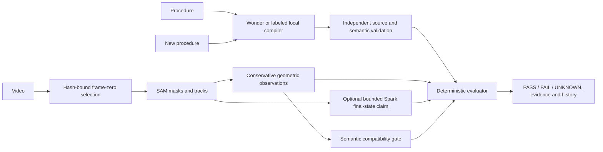

# Architecture and Meta evidence

FastAPI/Pydantic contracts separate compiler, tracker and observer. React exposes procedures, typed programs, video overlays, supporting frames and append-only comparisons. SQLite retains audit metadata and integer-money reservations. FFmpeg normalizes bounded uploads; new uploads retain a hash-bound decoder/PTS source map. One server process and two workers are supported. The application is intended for trusted local use, not unauthenticated public deployment.

| Model | Actual retained contribution | Independent evidence |
|---|---|---|
| Muse Wonder 1.0 | Original semantic compilation; nine captured responses across prior validation | [Capture index](../milestone-5/capture-index.json), [original generated graph](../milestone-5/generated-comparison.json), [source validator](../../backend/app/grounding.py) |
| SAM 3.1 | Five captured responses; object masks/tracks and frame-associated support | [Generated evidence](../milestone-5/generated-comparison.json), [SAM decoder/adapter](../../backend/app/sam.py), [captured media](../live-validation/live-api-v6-correct/video.mp4) |
| Muse Spark 1.3 | Three captured responses; bounded visible endpoint interpretations on selected camera prefixes | [Historical results](../milestone-5/live-results.json), [replay](../../scripts/replay_milestone5.py). **No Spark contribution to the generated order comparison.** |

[Official contract research](../meta-api-contracts.md) records request/cost boundaries. No real endpoint was called in this milestone. Captured results are historical live evidence; mocked HTTP tests are synthetic examples. Local revisions are labeled `local_rules`, never a new Wonder request.

Exact supporting intervals in the generated Meta run: `cv_object1_region1_20_23_0`, 0.750–1.125s, and `cv_object2_region1_54_58_0`, 2.167–2.583s. Supporting intervals differ from narrower decisive transition intervals. PASS requires exact typed arguments and disjoint ordering support; unsupported sterility blocks PASS. [Fresh browser export](browser-verification.json) records newly entered revisions and unchanged fingerprints.

The new local-CV upload/source-map scene is separate, explicitly labeled and uses no SAM. It must not be used to imply a retroactive source mapping for the historical Meta recording. [Local upload export](local-cv-upload.json) preserves that distinction.

Pending: three independently recorded controlled camera cases. Third-party research footage is excluded from all public assets. Neither region overlap nor final visibility establishes insertion, contact or hidden state.

The separate [synthetic trio](synthetic-validation.md) exercises the replaceable **local
rules → local OpenCV → geometric observer → same deterministic evaluator** path. It
does not invoke Wonder, SAM or Spark. Its reversed clip supplies independent positive
cup-first evidence; its occlusion clip invalidates identities via a coarse scene-motion
heuristic. Keep this supplementary path separate from historical captured Meta evidence.
